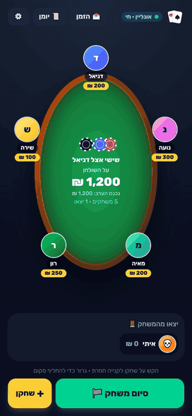
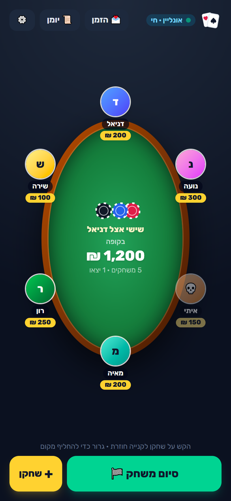
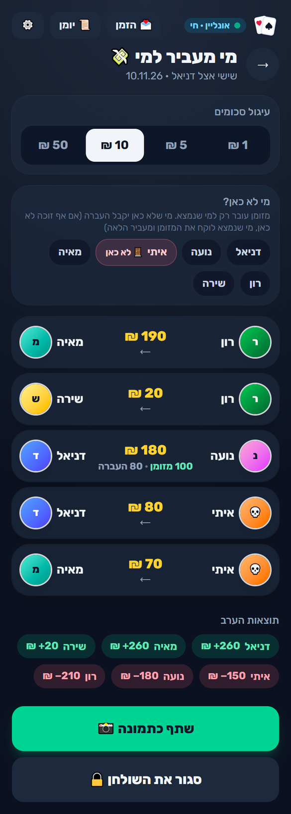
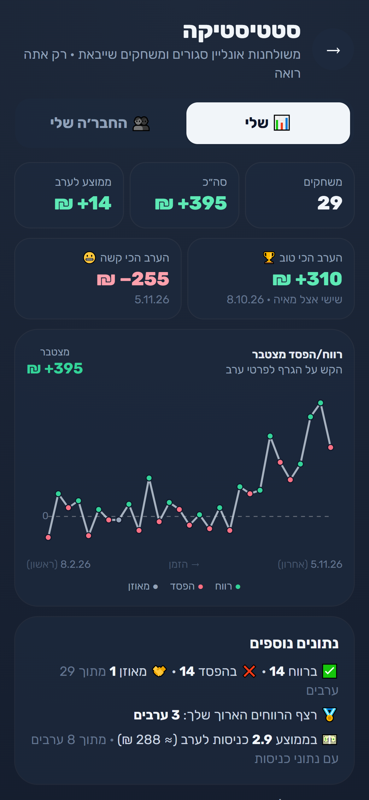
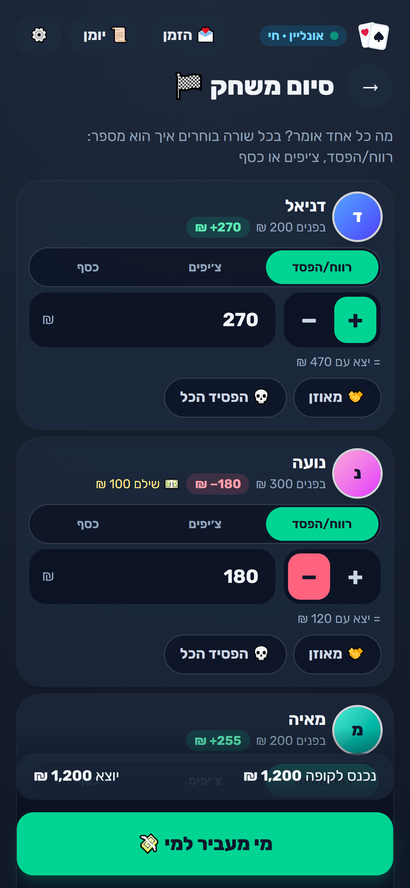
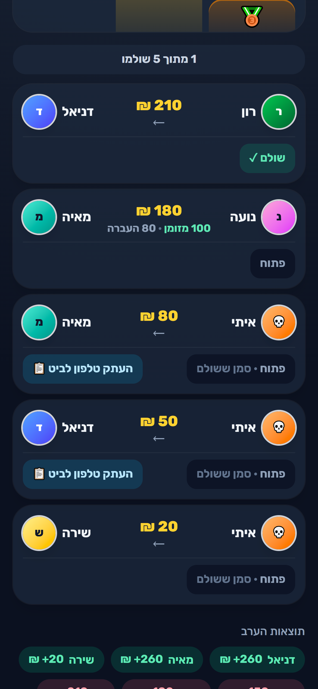
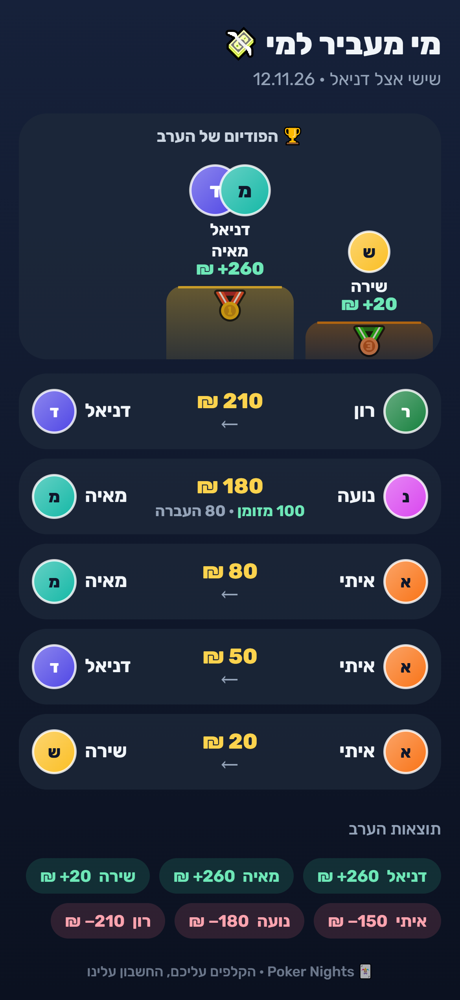
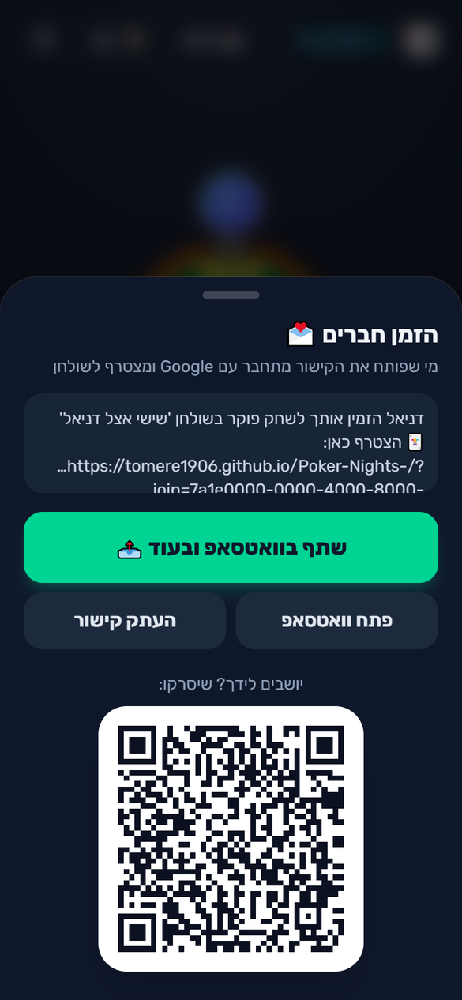
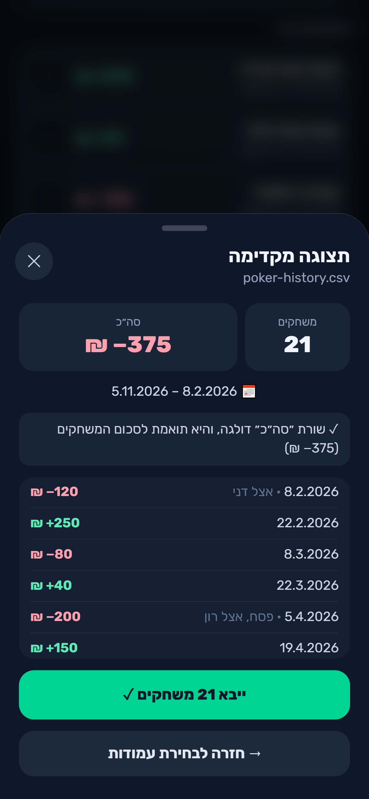
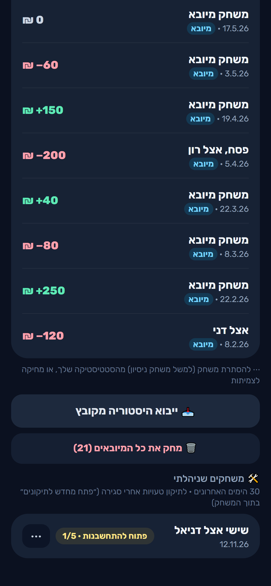

# Poker Nights 🃏

**Run a home poker night from your phone, and settle up in seconds.**
*הקלפים עליכם, החשבון עלינו* ("the cards are on you, the math is on us")

**Live app:** https://tomere1906.github.io/Poker-Nights-/ (Hebrew, mobile first, installable to the home screen)

<p align="center">
  
</p>

<p align="center"><sub>All screenshots use made-up demo players.</sub></p>

## The problem

It's 3 a.m., the game is over, and someone opens the calculator. Who bought in how many times? Who left early with chips? Someone already paid 200 in cash, so what do they still owe? Amounts like 152.5 don't split nicely, and nobody wants to make eight separate bank transfers. Settling up takes longer than the last hand and usually ends with "I'll trust you".

Poker Nights keeps track of the money during the night and does the math at the end: who pays whom, in round amounts, with as few transfers as possible.

## Features

<table>
  <tr>
    <td align="center"><br><sub>The live table</sub></td>
    <td align="center"><br><sub>Podium and who pays whom</sub></td>
    <td align="center"><br><sub>Personal stats</sub></td>
  </tr>
  <tr>
    <td align="center"><br><sub>End of the night</sub></td>
    <td align="center"><br><sub>"Paid ✓" and the Bit button</sub></td>
    <td align="center"><br><sub>Shared as an image</sub></td>
  </tr>
  <tr>
    <td align="center"><br><sub>Invite by WhatsApp or QR</sub></td>
    <td align="center"><br><sub>Importing past nights</sub></td>
    <td align="center"><br><sub>Imported nights and games I managed</sub></td>
  </tr>
</table>

### At the table

- **Online tables with live updates.** Everyone sees the same table on their own phone; a buy-in added by the manager appears on all phones within a second.
- **Invites by WhatsApp or QR.** One link: the friend signs in with Google, joins, and picks a free seat. If two friends tap the same seat at the same moment, the second one is told the seat was just taken and sees it filled.
- **Roles.** The manager runs the table and can appoint co-managers (buy-ins, seating, results). Players see everything and, if the manager allows it, add buy-ins for themselves only. Every change is written to a log that nobody can edit.
- **Leaving mid-game frees the seat.** A player who leaves ("lost it all", "even", or an amount) moves to a "left the game" strip under the table, so a full table has room for someone new. The middle of the table shows what's still **on the table** and, smaller, everything that came in tonight. The exit can be changed later or undone ("back in the game").
- **Chip value.** If a chip is worth 0.5 ₪, enter chip counts and the app converts them; buy-ins stay in shekels.

### End of the night

- **Three ways to enter each result:** profit/loss (with + and − buttons, since the iPhone number pad has no minus), chips, or money. Each player can use a different one; the others are shown small underneath ("= left with 470 ₪").
- **One source of truth per player.** What a player left with mid-game and what's typed at the end are the same number, so they can never disagree.
- **Cash payments.** Losers often pay part in cash on the spot. Each bill is recorded as a whole unit, never more than the player's loss, and the settlement only transfers what's still owed. Cash goes only to people who are still there; a winner who left early gets a bank transfer instead.
- **Rounding** to 1 / 5 / 10 / 50 ₪, so nobody transfers 37 ₪.
- **Settlement in round amounts with few transfers**, cash included.
- **The night's podium.** Gold, silver and bronze for the top three winners (ties share a place), on the screen and in the image shared to the WhatsApp group.

### Settling up

- **Open until everyone has paid.** Closing the table ends the game (results are saved and counted in stats right away), but it stays "open for settling" on everyone's start screen ("2 of 5 paid") until the last transfer is marked paid. The manager can also close it by hand.
- **"Paid ✓", live.** The payer, the receiver or a manager marks each transfer as paid; everyone sees it at once.
- **The Bit button.** One tap copies the receiver's phone number, shows the amount, and opens Bit. The number is visible only to people who still owe that person money, and only while the settling is open, enforced in the database.
- **Asked only when needed.** A winner who has no phone number saved is asked for it on the settlement screen, not at sign-up. Once it's saved, the Bit button appears for the payers by itself.

### Stats

- **Personal stats.** Games, total, average, best and worst night, and a chart of the running total over time with a dot for every night (green profit, red loss, gray break-even); tap it to see any night. Plus streaks, buy-in averages, and "my crew": your results against everyone you've played with. Only you see your stats.
- **Import your past nights** from a CSV or Excel file: pick which column is the date, the result and the note, see a preview (number of games, dates, total; a "Total" row is skipped and checked against the sum), then import. Imported nights are marked "מיובא", count only in your own stats, and can all be removed at once. A downloadable template is included.
- **Games I managed.** The last 30 days of games you ran, to reopen one and fix a mistake, remove it from the list, or (the original manager only) delete it for everyone.

### Everywhere

- **Clear Hebrew messages.** No technical errors: "no internet connection, try again", "you don't have permission for this", "this seat was just taken".
- **Always up to date.** When a new version is released, the app on the home screen updates itself the next time it's opened.
- **Local mode without sign-in.** The whole game on one phone, stored only on that phone.
- **Hebrew, right to left**, dark theme, big buttons for one-handed use at the table, works offline.

## How the settlement works

1. **Each player's result** = what they left with − what they put in.
2. **Rounding.** Every result is rounded to the table's unit (say 10 ₪). If the rounded results don't add up to exactly zero, the difference goes to the biggest winner, so the books always balance.
3. **Cash first.** Each cash bill goes *whole* to one winner who is still owed at least that much and is still at the table. A 200 note is never split in half; two 50s can go to two different people.
4. **Fewest transfers.** For what's left, the app searches for the plan with the fewest bank transfers. For up to 9 players it tries the possible pairings rather than taking a greedy shortcut, and it avoids tiny transfers under 20 ₪ unless there's truly no other way.
5. **One line per pair.** "Noa → Daniel 180 ₪ (100 cash · 80 transfer)": cash and transfer between the same two people are shown as one row.

The algorithm is a pure function in [`src/lib/settlement.js`](src/lib/settlement.js), covered by unit tests (including a real night's numbers and randomized games).

## Security

The app talks to the database directly from the browser with a *public* key, so the app itself can't be the wall. Every rule is enforced **inside the database** (PostgreSQL row-level security, triggers and column-level grants): who can see a table, who can add a buy-in, who can close the game, that results add up to zero, and that an ended game is locked.

- **475 database security tests** ([`supabase/tests/rls_test.sql`](supabase/tests/rls_test.sql)) try to break every rule as manager, co-manager, player, stranger and signed-out visitor.
- **58 outside attack checks** ([`supabase/tests/attack_test.mjs`](supabase/tests/attack_test.mjs)) hit the real database directly, bypassing the app, with only the public key: without an account, and with two real accounts trying to read, change, take over or listen in on each other's tables. All blocked.
- Emails are never shown to other users; stats are visible only to their owner; names are cleaned of hidden direction-control characters; sign-in is Google only.
- No secrets in the code or its git history; dependencies audited.

Full report: [SECURITY.md](SECURITY.md).

## How it was built

I'm not a programmer. I built Poker Nights with [Claude Code](https://claude.com/claude-code), Anthropic's AI coding agent. Claude Code wrote the code, the tests and the database migrations. My part was the product: deciding what it should do and how it should feel, setting the rules (how cash is split, what rounding means, who may do what), reviewing every step on my phone, and testing it with friends at real poker nights. Several features, like cash bills, absent players and chip value, came straight from problems we hit at the table.

## Tech stack

- **Frontend:** React 18, Vite, Tailwind CSS, a small service worker (PWA, offline)
- **Backend:** Supabase: PostgreSQL with row-level security, Google sign-in, Realtime for live updates
- **Tests:** Vitest (game logic, settlement, stats), SQL security tests, an outside attack script
- **Hosting:** GitHub Pages, deployed by GitHub Actions on every push to `main` (tests must pass first)

## Run locally

```bash
npm install
cp .env.example .env.local   # add your Supabase project URL and publishable key
npm run dev                  # http://localhost:5173
npm test                     # unit tests
npm run build                # production build
```

Without a Supabase project the app still runs, in local mode only.

To set up your own database: run the files in [`supabase/migrations/`](supabase/migrations/) in order in the Supabase SQL editor, then [`supabase/tests/rls_test.sql`](supabase/tests/rls_test.sql). It should end with "ALL 475 TESTS PASSED". Enable Google as the only sign-in provider.

## Roadmap

- A list view of the table (names, buy-ins, totals) next to the oval table
- A "new invite link" button, so a leaked link can be cancelled mid-game
- Self-service account deletion (today it's done on request)
